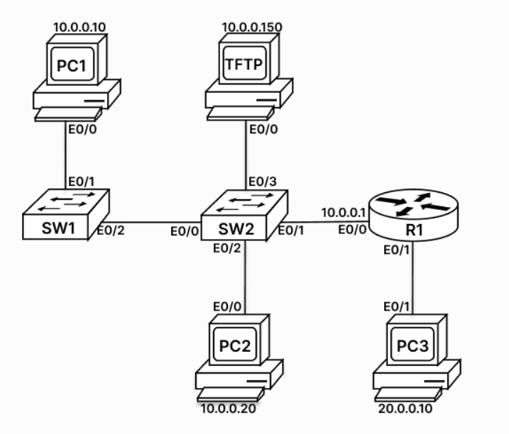

# Configuring SSH Remote Access on a Cisco Router

A hands-on CCNA lab where I enabled secure remote management (SSH version 2) on a Cisco router (R1) using local authentication and RSA keys, and then tested the connection from a switch (SW2).

## Objective
- Set the domain name on the router (hostname R1)
- Generate RSA keys (2048-bit)
- Enable SSH version 2
- Create a local user account
- Secure privileged mode with an enable secret
- Allow remote login on the VTY lines using the local user database
- Test SSH access from SW2

## Topology


R1 is the router being managed. I took remote access (SSH) into R1 from the switch SW2, which acts as the SSH client. R1 Ethernet0/0 has IP 10.0.0.1.

## Tools Used
- Cisco IOS (router R1)
- Cisco Packet Tracer / lab environment
- SW2 (second device) used as the SSH client

---

## Part 1: Configuration on R1

### Step 1: Enter global configuration mode
```
R1>en
R1#config t
Enter configuration commands, one per line.  End with CNTL/Z.
R1(config)#
```

### Step 2: Set the domain name
```
R1(config)#ip domain-name rst.net
R1(config)#
```
No output is shown. SSH needs a hostname and a domain name, because the RSA key name is built from both (here: `R1.rst.net`).

### Step 3: Enable SSH version 2
```
R1(config)#ip ssh version 2
Please create RSA keys to enable SSH (and of atleast 768 bits for SSH v2).
R1(config)#
```
The router warns that RSA keys are needed first. SSH version 2 requires a key of at least 768 bits.

### Step 4: Generate the RSA keys
```
R1(config)#crypto key generate rsa
The name for the keys will be: R1.rst.net
Choose the size of the key modulus in the range of 360 to 4096 for your
  General Purpose Keys. Choosing a key modulus greater than 512 may take
  a few minutes.

How many bits in the modulus [512]: 2048
% Generating 2048 bit RSA keys, keys will be non-exportable...
[OK] (elapsed time was 5 seconds)

R1(config)#
*Oct  4 13:57:14.424: %SSH-5-ENABLED: SSH 2.0 has been enabled
R1(config)#
```
- The key name `R1.rst.net` comes from the hostname and the domain name
- I chose 2048 bits for better security
- After the keys were created, the router confirmed: `SSH 2.0 has been enabled`

### Step 5: Create a local user
```
R1(config)#username cisco secret cisco123
R1(config)#
```
No output is shown. The password is stored as a hash because I used `secret`.

### Step 6: Set the enable secret
```
R1(config)#enable secret sunny
R1(config)#
```
No output is shown. This protects privileged EXEC mode.

### Step 7: Configure the VTY lines
```
R1(config)#line vty 0 4
R1(config-line)#login local
R1(config-line)#transport input all
R1(config-line)#exit
R1(config)#
```
No output is shown for these commands.
- `login local` makes the router check the local username database when someone connects
- `transport input all` allows remote logins on the VTY lines

### Step 8: Leave configuration mode
```
R1(config)#end
R1#
*Oct  4 14:01:36.564: %SYS-5-CONFIG_I: Configured from console by console
```
The `%SYS-5-CONFIG_I` message confirms the configuration was changed from the console.

---

## Part 2: Testing SSH from SW2

### Step 1: Connect to R1 using SSH
```
SW2>en
SW2#ssh -l cisco 10.0.0.1
[Connection to 10.0.0.1 closed by foreign host]
SW2#ssh -l cisco 10.0.0.1
[Connection to 10.0.0.1 closed by foreign host]
SW2#ssh -l cisco 10.0.0.1
Password:

R1>
```
The first two attempts were closed by R1, most likely because the VTY login was not configured on R1 yet at that time. The third attempt worked: R1 asked for the password of the user `cisco` and gave the user EXEC prompt `R1>`.

### Step 2: Enter privileged mode on R1
```
R1>en
Password:
R1#
```
The enable secret was accepted and the prompt changed to `R1#`.

### Step 3: Check the interfaces on R1
```
R1#sh ip int brief
Interface                  IP-Address      OK? Method Status                Protocol
Ethernet0/0                10.0.0.1        YES TFTP   up                    up
Ethernet0/1                unassigned      YES TFTP   up                    up
Ethernet0/2                unassigned      YES TFTP   administratively down down
Ethernet0/3                unassigned      YES TFTP   administratively down down
```
- Ethernet0/0 has the IP 10.0.0.1 and is up/up. This is the interface SW2 connects to
- Ethernet0/1 is up/up with no IP address
- Ethernet0/2 and Ethernet0/3 are administratively down

---

## Security Note
`transport input all` allows both Telnet and SSH. In a real network, use `transport input ssh` so that only encrypted SSH connections are accepted, because Telnet sends data (including passwords) in plain text.

## Files in this repo
| File | Description |
|------|-------------|
| `README.md` | Lab documentation with command output |
| `R1-config.txt` | Router configuration commands |
| `session-log.txt` | Full console session from R1 and SW2 |
| `ssh.png` | Topology diagram |

## What I Learned
- Why SSH is preferred over Telnet for remote access
- How the hostname, domain name and RSA keys work together
- How local authentication works on VTY lines
- How to test SSH access from another device
